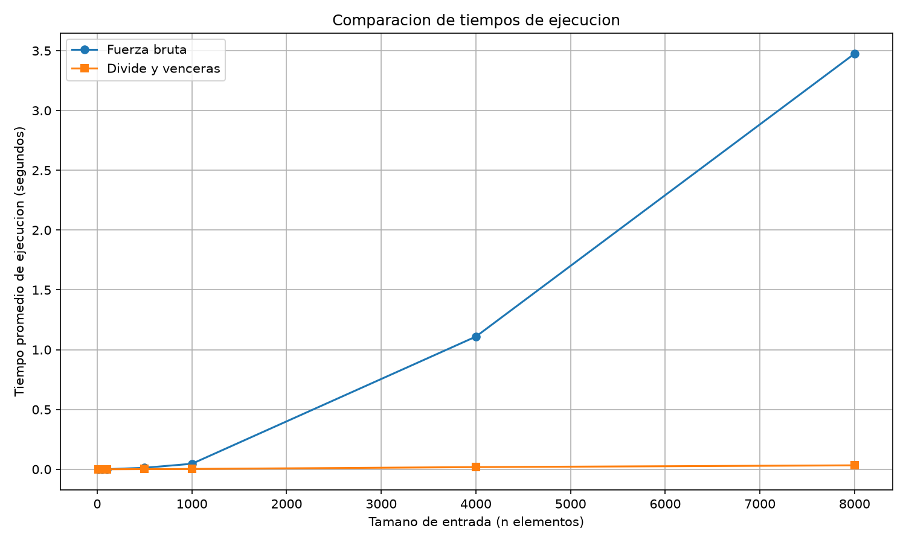

# Isabella Bermúdez Arboleda

## Instrucciones para ejecutar el laboratorio

Primero hay que activar el entorno virtual que está en la raíz del repositorio. Desde la raíz del repo:

- En PowerShell: `.\venv\Scripts\Activate.ps1`

El entorno ya tiene matplotlib instalado (registrado en `requirements.txt` en la raíz), así que no hay que instalar nada más.

Luego hay que entrar a esta carpeta:

```
cd laboratorios/lab2-divide-y-vencer
```

Y desde ahí:

- Pruebas de la Parte 1: `python pruebas.py`
- Medición y gráfica de la Parte 2: `python medicion.py`

Las pruebas imprimen `Todas las pruebas pasaron correctamente.` si todos los `assert` se cumplen. La medición imprime en la terminal el tiempo de cada algoritmo por tamaño y guarda la gráfica en `graficas/tiempo_vs_n.png`.


## Parte 1 — Implementar y verificar las dos soluciones

Código: [subarreglo.py](subarreglo.py) · [pruebas.py](pruebas.py)

En `subarreglo.py` están las tres funciones indicadas por el laboratorio:
- `subarreglo_fuerza_bruta`, que prueba todos los pares de días acumulando la suma dentro del ciclo
- `suma_cruzada`, que recorre desde el punto medio hacia la izquierda y hacia la derecha
- `subarreglo_maximo`, que divide el rango en dos mitades, resuelve cada una de forma recursiva, calcula el caso cruzado y se queda con el tramo de mayor suma de los tres.

Para verificar las soluciones, `pruebas.py` usa `assert`. Los casos cubiertos son:

|                   Caso                      |             Lista              | Suma esperada |
|---------------------------------------------|--------------------------------|---------------|
| Serie de ocho días de la situación problema | `[-3, 5, -2, 8, -6, 3, 9, -4]` | 17            |
| Un solo elemento                            | `[-4]`                         | -4            |
| Todos los valores negativos                 | `[-10, -4, -7, -2, -9]`        | -2            |
| Todos los valores positivos                 | `[3, 6, 2, 5]`                 | 16            |
| La mejor racha cruza el punto medio         | `[3, -2, 5, -1, 4, -6]`        | 9             |
| 20 listas aleatorias                        | —                              |ambas dan igual|


## Parte 2 — Medir y graficar

Código: [medicion.py](medicion.py)



**Cómo se midió:**

- Tamaños de entrada: 10, 50, 100, 500, 1000, 4000 y 8000.
- Los datos se generan con una semilla fija (`random.Random(2026)`) como enteros entre -100 y 100, y la misma lista se usa para los dos algoritmos en cada tamaño.
- Solo se cronometra la llamada al algoritmo con `time.perf_counter()`; la generación de los datos queda por fuera.
- En cada tamaño se verifica con `assert` que los dos algoritmos devuelven la misma suma.
- Cada medición se repite 3 veces y se reporta el promedio.

**Resultados obtenidos:**

| n    | Fuerza bruta (s) | Divide y vencerás (s) |
|------|------------------|-----------------------|
| 10   | 0.000012         | 0.000025              |
| 50   | 0.000105         | 0.000099              |
| 100  | 0.000408         | 0.000198              |
| 500  | 0.012617         | 0.001561              |
| 1000 | 0.045937         | 0.002666              |
| 4000 | 1.109541         | 0.018159              |
| 8000 | 3.475390         | 0.032825              |


## Parte 3 — Análisis

### 1. Recurrencia
En el algoritmo de divide y vencerás, el arreglo se divide en dos mitades. Por eso se resuelven dos subproblemas de tamaño n/2. Después se busca el mejor tramo que cruza el punto medio, recorriendo las dos mitades, lo que cuesta Θ(n).

La recurrencia es:

T(n) = 2T(n/2) + Θ(n)

Aplicando el método maestro, tenemos a = 2, b = 2 y f(n) = Θ(n). Como n^(log₂ 2) = n y f(n) = Θ(n), entonces f(n) = Θ(n^(log_b a)), que es la condición del caso 2 del método maestro. Por tanto, la complejidad es Θ(n log n).

En fuerza bruta se revisan todos los posibles tramos consecutivos. Como la suma se acumula dentro de dos ciclos anidados, se realizan aproximadamente n(n + 1)/2 operaciones. Por eso su complejidad es Θ(n²).

### 2. Lo medido contra lo esperado
En la gráfica se puede evidenciar que ambos tiempos se encuentran condicionados en la medida que el tamaño de la entrada aumenta, pero fuerza bruta crece abrutamente y mucho más rápido a comparacion de divide y venceras. Por ejemplo, al pasar de 4.000 a 8.000 elementos, su tiempo aumenta de 1,109541 s a 3,475390 s, mientras que divide y vencerás pasa de 0,018159 s a 0,032825 s.

Al duplicar la entrada de 50 a 100 elementos, el tiempo medido de fuerza bruta aumenta aproximadamente 3,89 veces y el de divide y vencerás, 2 veces. Estos factores se obtienen dividiendo el tiempo de ejecución con 100 elementos entre el tiempo con 50. Entre 4.000 y 8.000 elementos, los factores son aproximadamente 3,13 y 1,81. Teóricamente, se esperan factores cercanos a 4 para Θ(n²) pues 2² =4 y cercanos a 2 para Θ(n log n)(porque 2 * log 8000/log 4000=2,17), aunque este último aumenta ligeramente por el factor logarítmico. Las diferencias se pueden explicar por el tamaño de las entradas y las variaciones normales de las mediciones.

### 3. Tamaños pequeños
En las mediciones, divide y vencerás empieza a ser más rápido entre 10 y 50 elementos. Con 10 elementos, fuerza bruta es mas rapida porque tarda 0,000012 s, mientras que divide y vencerás tarda 0,000025 s. Esto ocurre porque dividir el arreglo y realizar llamadas recursivas también tiene un costo. Con entradas pequeñas, ese trabajo adicional puede pesar más que revisar directamente los tramos. Con 50 elementos, el tiempo de divide y venceras, empieza a ser menor que el de la fuerza bruta(0,000099 < 0,000105) . Sin embargo, no es una diferencia notable; A partir de los 100 elementos, divide y venceras gana de forma notable: 0,000198 s contra 0,000408 s de fuerza bruta (casi la mitad)

### 4. ¿Cuándo conviene dividir?
Para encontrar el máximo de un arreglo, recorrer los n elementos y conservar el mayor valor cuesta Θ(n). Si lo dividimos en dos mitades, debemos encontrar el máximo de cada una y comparar ambos resultados, lo que da la recurrencia T(n) = 2T(n/2) + Θ(1). Por el método maestro, aplica el caso 1, porque f(n) = Θ(1) crece mas lento que n^(log₂ 2) = n . Por lo tanto, su solución tambien es Θ(n). Ambos métodos tienen la misma complejidad, pero el recorrido directo evita las llamadas recursivas(varias veces).

### 5. Concepto para la gerente
Recomendaría divide y vencerás para la gerente y la cooperativa, ya que en las pruebas fue mucho más eficiente con entradas grandes.Para 8.000 registros tardó alrededor de 0,033 segundos, mientras que fuerza bruta tardó 3,475 segundos.

Ahora, para un millón de registros, se hace una estimación, tomando como referencia la medición de 8.000.
Al pasar de 8.000 a 1.000.000 rgeistros , la entrada crece 125 veces , pero el tiempo no crece igual en los dos algoritmos:

- **Fuerza bruta (n²):** el tiempo crece 125² = 15.625 veces y lo multiplicamos el tiempo de 8.000: 3,475 × 15.625 ≈ 54.300 s que seria unas 15 horas.
- **Divide y vencerás (n log n):** el tiempo crece 125 × log(1.000.000) / log(8.000) ≈ 192 veces , multiplicando por el tiempo de 8.000 elementos como referencia seria 0,033 × 192 ≈ 6 segundos.

 Estos valores se calculan tomando los tiempos medidos como referencia y ajustándolos según el crecimiento esperado de cada algoritmo: n² para fuerza bruta y n log₂ n para divide y vencerás. 