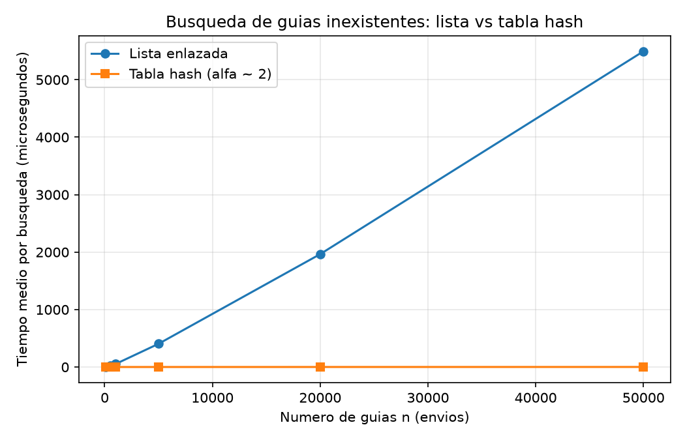
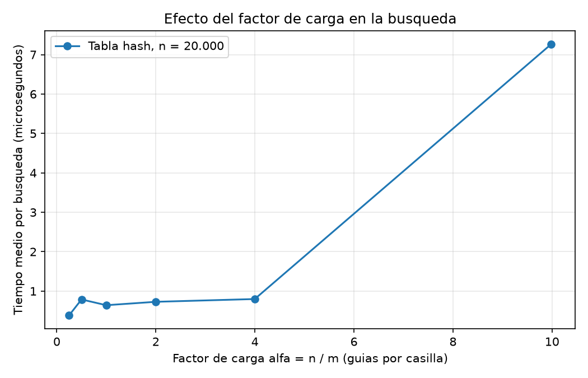

# Isabella Bermúdez Arboleda

## Instrucciones para ejecutar el laboratorio

Primero hay que activar el entorno virtual que está en la raíz del repositorio. Desde la raíz del repo:

- En PowerShell: `.\venv\Scripts\Activate.ps1`

El entorno ya tiene matplotlib instalado. 

## Parte 1 — Implementar y verificar las dos estructuras

Código: [`estructuras.py`](estructuras.py) · [`pruebas.py`](pruebas.py)

Se verificó las dos estructuras con pruebas assert en pruebas.py, comprobando que la inserción y la búsqueda devuelven los resultados esperados y que ademas,la lista y tabla responden lo mismo ante los mismos datos.

Casos que cubren las pruebas:

- **Lista enlazada:** inserción de tres guías con distintos estados, búsqueda exitosa de cada una, búsqueda de una guía inexistente (devuelve None) y comprobación de que el tamaño es 3.
- **Colisión forzada:** Siendo m = 7, las guías 10, 24 y 17 caen en la casilla 3. Se insertan y se recuperan las tres, y la lista de esa casilla tiene longitud 3, lo que confirma que el encadenamiento resuelve la colisión.
- **Búsqueda infructuosa en la tabla:** una guía no insertada devuelve None.
- **Factor de carga:** tras las tres inserciones con m = 7, factor_carga() da 3/7.
- **Colecciones aleatorias:** 20 colecciones de 50 guías únicas con estados al azar. En cada una, lista y tabla devuelven el mismo estado para las guías existentes y None para 20 guías inexistentes, y ambas conservan los 50 elementos insertados.

## Parte 2 — Medir y graficar

Código: [`medicion.py`](medicion.py)

### Experimento A — Lista frente a tabla

**Cómo se midió:**

- Tamaños de entrada: 100, 500, 1000, 5000, 20000 y 50000 guías.
- Las guías son numeros enteros distintos , generados con una semilla fija (`random.Random(42)`), y las mismas guías se insertan en la lista y en la tabla para cada n.
- Para cada n, la tabla usa un m primo cercano a n/2, de modo que α queda alrededor de 2.
- En cada n se hacen 200 búsquedas de guías inexistentes, generadas con la semilla 7, y se calcula el tiempo medio por búsqueda.
- Solo se cronometran las búsquedas con `time.perf_counter()`; la construcción de las estructuras y la generación de los datos quedan por fuera.
- En cada n se verifica con `assert` que, para una muestra de guías existentes, la lista y la tabla devuelven el mismo estado.
- Cada medición se repite 3 veces y se reporta el promedio.

**Resultados obtenidos:**

| n     | m     | α    | Lista (µs) | Tabla hash (µs) |
|-------|-------|------|------------|-----------------|
| 100   | 53    | 1,89 | 4.97       | 0.271           |
| 500   | 251   | 1,99 | 26.67      | 0.306           |
| 1000  | 503   | 1,99 | 51.73      | 0.375           |
| 5000  | 2503  | 2,00 | 404.40     | 0. 670          |
| 20000 | 10007 | 2,00 | 1964.83    | 0.874           |
| 50000 | 25013 | 2,00 | 5494.67    | 1.294           |

En la gráfica, la curva de la tabla hash parece ser muy baja porque sus tiempos que son menores de 1 µs, mientras que los de la lista llegan a miles de microsegundos. Debido a esta gran diferencia, la curva de la tabla hash queda pegada al eje x. Sin embargo, esto no significa que su tiempo sea cero, ya que sus valores se puede evidenciar en la anterior tabla y en los resultados del script pruebas.py

### Experimento B — Efecto del factor de carga

**Cómo se midió:**

- Se fijó n = 20.000 guías, generadas con la semilla 42.
- Se construyeron seis tablas con m primo cercano a n/α, para α objetivo de 0,25; 0,5; 1; 2; 4 y 10.
- En cada tabla se hicieron 200 búsquedas de guías inexistentes y se calculó el tiempo medio por búsqueda, repitiendo 3 veces y promediando.
- Solo se cronometran las búsquedas con time.perf_counter(), y se verifica con assert que lista y tabla coinciden en una muestra de guías existentes.

**Resultados obtenidos:**

| α objetivo | m     | α real | Tabla hash (µs) |
|------------|-------|--------|-----------------|
| 0,25       | 80021 | 0,250  | 0.386           |
| 0,5        | 40009 | 0,500  | 0.788           |
| 1          | 20011 | 0,999  | 0.642           |
| 2          | 10007 | 1,999  | 0.728           |
| 4          | 5003  | 3,998  | 0.799           |
| 10         | 2003  | 9,985  | 7.268           |

## Parte 3 — Análisis

### 1. Costo teórico
En la lista enlazada, buscar una guía que no existe obliga a recorrer los n nodos, ya que se necesita llegar al final para asegurar que no está. Por eso el costo es Θ(n). En la tabla hash, primero se calcula la casilla con h(k) = k mod m, que cuesta Θ(1), y luego se recorre solo la lista de esa casilla. Si las guías se reparten de forma pareja, cada lista tiene en promedio n/m = α nodos, por lo que el costo promedio es Θ(1 + α).

Este resultado se sostiene en el supuesto de hash uniforme simple: cada guía tiene la misma probabilidad de caer en cualquiera de las m casillas, sin depender de las demás. Si todas las guías cayeran en la misma casilla, la tabla se comportaría como una sola lista de n nodos. Por tanto, buscar costaría Θ(n), igual que en la lista enlazada.

### 2. Lo medido contra lo esperado
En la primera gráfica, la lista crece en línea recta, mientras que la tabla se ve pegada al eje porque sus valores son menores a 1 µs.
Por ejemplo, al pasar de 5000 a 20000 guías (n × 4), el tiempo de la lista aumenta de unos 400 µs a unos 2000 µs, es decir, aproximadamente 4.9 o 5 veces. Entre 20000 y 50000 guías (n × 2,5), pasa de 2000 µs a unos 5500 µs, un factor cercano a 2,8. Teóricamente, Θ(n) predice factores de 4 y 2,5, por lo que los datos coinciden, con una pequeña diferencia que se puede explicar por la error humano al predecir un numero exacto,memoria caché y otras variaciones de la medición. La tabla, en cambio, pasó de 0,78 µs a 0,73 µs entre 5000 y 20000 guías (factor ≈ 0,9), lo que coincide con Θ(1): con α fijo en 2, el tiempo no depende de n.

En la segunda gráfica, con n = 20000, el tiempo se mantiene entre 0,4 y 0,8 µs mientras α va de 0,25 a 4, y sube a unos 7,3 µs con α = 10. Esto tiene coherencia con Θ(1 + α) en que el tiempo crece con α, pero el salto de α = 4 a α = 10 que equivale unas 9 veces mas es mayor que el esperado (11/5 = 2,2). Cuando α es pequeño, el costo fijo de calcular el hash y acceder a la casilla pesa más que recorrer la cadena, por eso la curva se ve plana al inicio.

### 3. Colisiones
Una colisión ocurre cuando dos guías distintas tienen el mismo valor de hash y, por tanto, les corresponde la misma casilla. Esto ocurre porque aunque la tabla tenga más casillas que guías, hay muchas más guías posibles que casillas. Por ejemplo, con m = 7, las guías 10, 24 y 17 dan 3 al calcular k mod 7, así que las tres caen en la casilla 3.

Con encadenamiento, esas tres guías quedan enlazadas en la lista de la casilla 3. Su ventaja es que es simple, nunca se llena y funciona con α mayor que 1; su costo es la memoria extra de los nodos y que las listas largas hacen más lenta la búsqueda. Con direccionamiento abierto, si la casilla 3 está ocupada, se prueba otra casilla siguiendo una secuencia, y todo se guarda dentro del arreglo. Esto permite que no usa nodos ni punteros sino que su costo es que necesita α < 1, se degrada mucho cuando la tabla se llena y borrar es más complicado.

### 4. Tabla hash o árbol de búsqueda
La tabla hash no sirve para el monitoreo por rango, porque la función hash reparte las guías sin conservar el orden, es decir, dos guías consecutivas, como 1000000010 y 1000000011, quedan en casillas distintas. Para encontrar las guías entre X y Y habría que revisar todas las casillas. Un árbol de búsqueda binario sí sirve, porque las guías menores quedan a la izquierda y las mayores a la derecha. Se busca X y se hace un recorrido en orden hasta llegar a Y, y las guías salen ya ordenadas.

Si las 400000 guías llegaran ordenadas y se insertaran una a una, cada una quedaría a la derecha de la anterior y el árbol sería una cadena. Su altura sería de unos 400.000 y buscar una guía costaría hasta unas 400.000 comparaciones. En un árbol equilibrado, la altura es aproximadamente log₂(400.000) ≈ 18,6, es decir, unas 19 comparaciones. Por tanto, el árbol equilibrado es unas 21.000 veces mejor en el peor caso.

### 5. Concepto para la jefa de operaciones
Recomendaríapara la jefa de operaciones una tabla hash para las consultas puntuales del call center y un árbol de búsqueda equilibrado para el monitoreo por rango. La tabla resuelve rápido el caso del operador, incluso con guías inexistentes, y el árbol permite listar rangos ordenados sin revisar todo.

Ahora, para 5000000 de envíos, se hace una estimación, tomando como referencia la medición de 50000 guías:

- **Lista enlazada (Θ(n)):** la entrada crece 100 veces y la gráfica muestra una línea recta, por lo que el tiempo también crece unas 100 veces: 5.480 µs × 100 ≈ 548.000 µs, es decir, cerca de 0,55 s por búsqueda.
- **Tabla hash (Θ(1 + α)):** si se mantiene α cerca de 2 (aumentando m a medida que crece n), el tiempo no depende de n, así que se espera un valor del mismo orden que el medido, cerca de 1 µs. Podría ser algo mayor por efectos de memoria caché con tantos datos.

